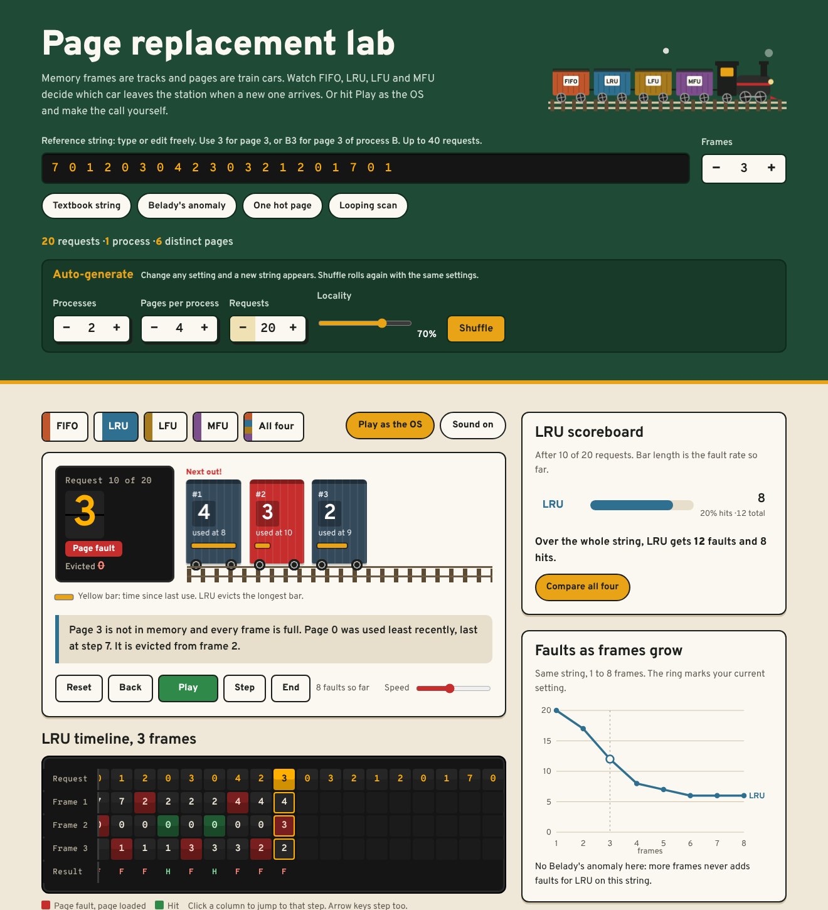
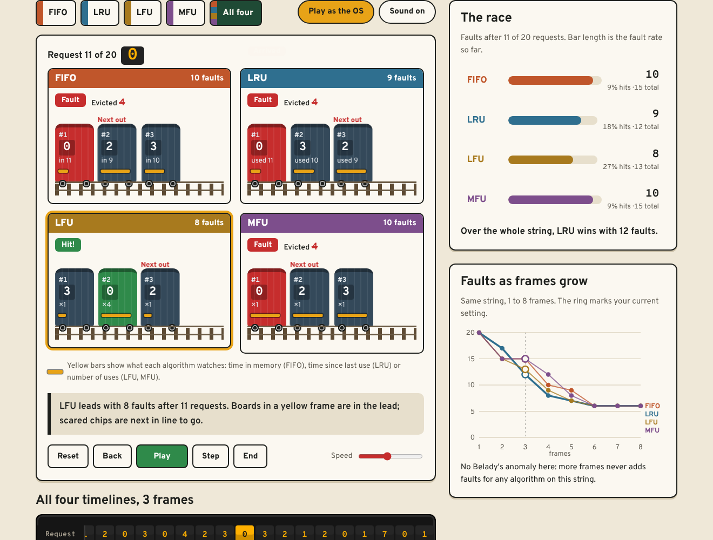
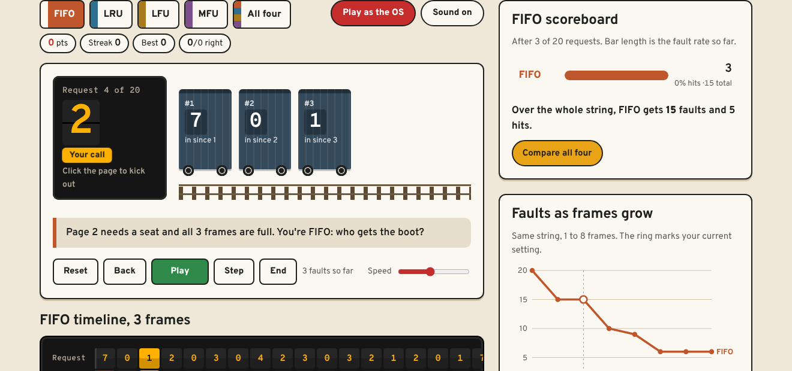
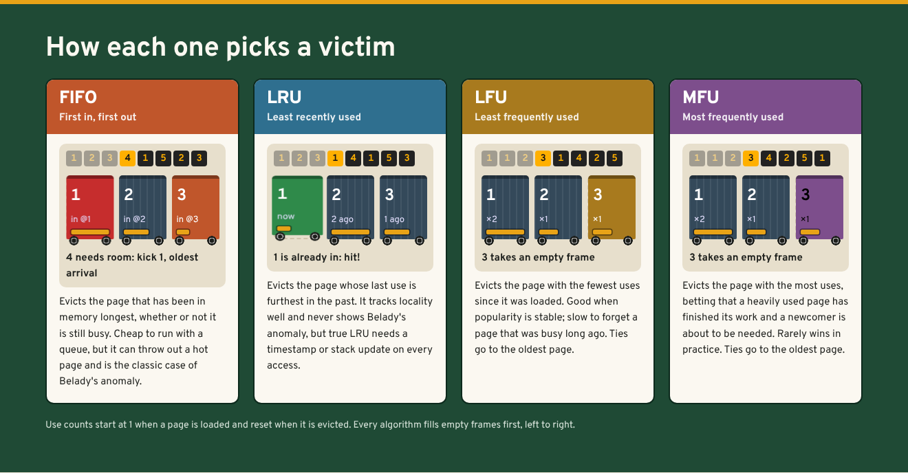
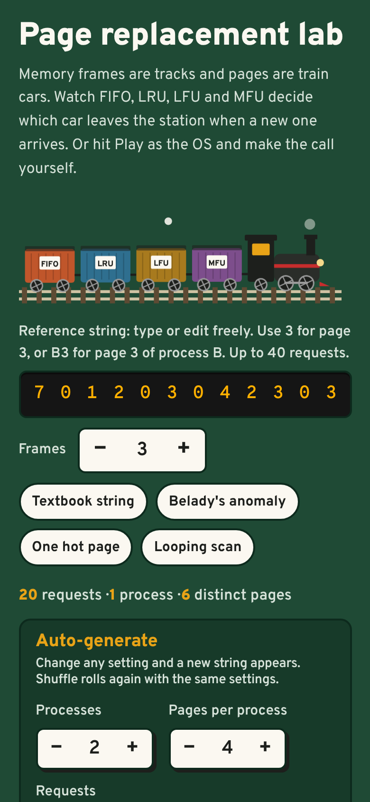

# Page Replacement Lab

An interactive, train-yard-themed simulator for four page replacement algorithms: **FIFO, LRU, LFU and MFU**. Feed a reference string into memory, step through it one request at a time, and watch each algorithm decide which page to evict, with an explanation for every decision.

The whole app is a single file, `index.html`, with no build step and no dependencies.

## Run it

- **Locally:** download or clone the repo and open `index.html` in any modern browser.
- **GitHub Pages:** in the repo's *Settings → Pages*, set the source to *Deploy from a branch*, branch `main`, folder `/ (root)`. The app will be live at `https://rok-kyu.github.io/Pages_Simulator/`.

## Features

- **Four algorithms:** FIFO, LRU, LFU and MFU, one at a time or all four side by side.
- **Step-by-step playback:** Play/Pause, Step, Back, Reset, End, a speed slider, the arrow keys, or click any column of the timeline to jump to that step.
- **Live memory board:** frames are drawn as memory chips. Each step shows the request, whether it's a hit or a page fault, which page was evicted and why, and which page is next in line to go.
- **Timeline grid:** the full history of every frame, with faults and hits highlighted.
- **The race:** fault counts and hit rates at the current step. With one algorithm selected it shows only that algorithm; the All four view compares them and names the winner.
- **Faults vs. frames chart:** faults for 1 to 8 frames for each algorithm, with automatic detection of **Belady's anomaly**.
- **Play as the OS:** a game mode. Whenever memory is full, you pick the page the algorithm would evict. You get points, streak bonuses and feedback on each answer.
- **Algorithm demos:** each algorithm card has a looping mini simulation showing how it picks a victim, and each header mascot moves in its own style.
- **Metric bars:** every memory chip has a yellow bar showing what the algorithm watches: time in memory (FIFO), time since last use (LRU) or number of uses (LFU, MFU).
- **Train yard look:** memory frames are tracks and pages are boxcars. New pages roll in, evicted pages depart in a puff of steam, and the timeline is a split-flap departure board. Railway green, cream and signal colours, with the Overpass signage typeface.
- **Animations and sound:** bell, chuff and whistle sound effects; pages travel from the request ticket into their track, evicted cars pull out of the station with a "departing" sign and a puff of steam, plus confetti and sound effects. Sound can be switched off, and animations turn off automatically if the device is set to reduce motion.

## Inputs

| Setting | Range | Notes |
|---|---|---|
| Reference string | up to 40 requests | Type freely. Use `3` for page 3, or `B3` for page 3 of process B. Spaces or commas. |
| Frames | 1 to 8 | Number of physical frames in memory. |
| Processes | 1 to 6 | Auto-generate: processes are named A to F. |
| Pages per process | 1 to 12 | Auto-generate. |
| Requests | 5 to 40 | Auto-generate. |
| Locality | 0% to 100% | Auto-generate: how often a process reuses one of its recently used pages. |

Changing any auto-generate setting makes a new string immediately; **Shuffle** rolls again with the same settings. Presets are included for the textbook string, Belady's anomaly, one hot page, and a looping scan.

With more than one process, all processes share the same frames (**global replacement**), so a process can evict another process's page.

## Algorithm rules

| Algorithm | Evicts | Tie-break |
|---|---|---|
| FIFO | The page that has been in memory longest | — |
| LRU | The page whose last use is furthest in the past | — |
| LFU | The page with the fewest uses | Oldest loaded page |
| MFU | The page with the most uses | Oldest loaded page |

- Empty frames are always filled first, left to right.
- For LFU and MFU, a page's use count starts at 1 when it is loaded and resets when it is evicted.

Check: on the textbook string `7 0 1 2 0 3 0 4 2 3 0 3 2 1 2 0 1 7 0 1` with 3 frames, FIFO gives 15 faults and LRU gives 12.

Your settings are remembered in your browser (localStorage) between visits.
